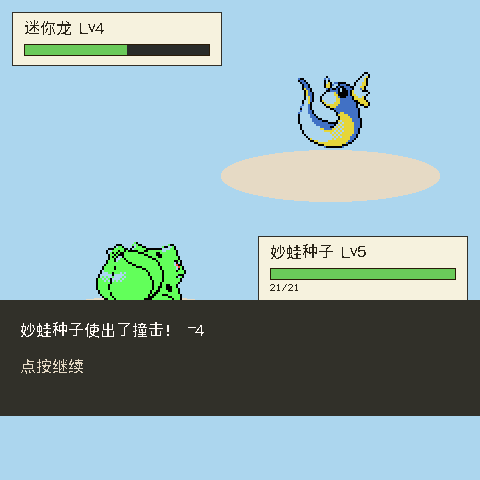
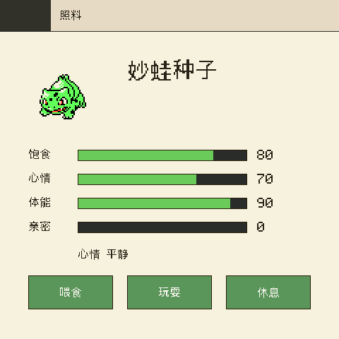
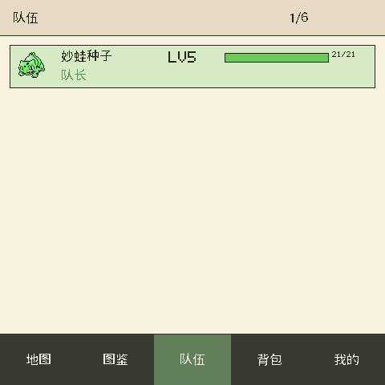

# PokeGo for Mosaico 🎮

**把宝可梦装进 480×480 触摸小屏：走草丛、遇野生、回合制对战、时机条捕捉、图鉴集齐 151 只。**

这是一个跑在 ESP-Mosaico 掌机（ESP32-S3 + 1.28 寸方形触摸屏 + ES8311 喇叭）上的
宝可梦同人养成游戏。全部玩法引擎移植自开源项目
ESP32-PokemonGo（PokeWalk）（原跑在 FoloToy 小
按键机上），针对触摸大屏重做了全部操作界面，并新增了原版没有的**自由行走地图**。

<p align="center">
  
  
  
</p>

---

## 能玩什么

- 🗺️ **一张能走的世界**：小镇、平原、森林、大湖、山地。手指点哪，角色就
  自动寻路走过去。走进草丛会惊动野生宝可梦——越深的地方、越远的山头，
  出现的种类越强、越稀有。
- ⚔️ **正经的回合制对战**：初代金银版机制——18 种属性相克、命中/要害、
  睡眠中毒麻痹混乱等状态、蓄力招、替身、变身……151 只宝可梦、191 个招式
  全部在列。点招式打，打不过还能跑（速度快的必跑掉）。
- 🎯 **时机条捕捉**：把对面打残血窗口会变宽，用好球窗口更宽，伙伴心情好
  也能加宽。指针扫到绿框里按下，就抓住了。队伍满 6 只自动进仓库。
- 📕 **图鉴 151**：目击、捕获、闪光（异色）分开记录，网格页滑动浏览。
- 🥚 **养成与照料**：喂食、玩耍、休息影响饱食/心情/体能三条数值——心情
  消沉的伙伴打架没力气、抓宠窗口也窄。升级、进化石、亲密度都能触发进化。
- 💰 **经济闭环**：打赢赚金币 → 去市集买精灵球、回复水、树果 → 敢走更深
  的草丛 → 抓更强的宝可梦。

## 怎么玩

屏幕底部常驻五个标签：**地图 / 图鉴 / 队伍 / 背包 / 我的**，随时一键切换。

| 想做什么 | 怎么操作 |
|---|---|
| 开局 | 点一只初始伙伴，再点一次确认 |
| 移动 | 地图上点任意可达位置，角色自动走过去 |
| 遇敌 | 走进高草丛，几步之内就会触发 |
| 对战 | 点「攻击」选招式；对面残血时点「投球」去抓 |
| 回复 | 走回小镇的红十字房子，全队免费回满 |
| 买东西 | 小镇的「S」房子是市集；「我的」页也能进 |
| 照料伙伴 | 「我的」→「照料」，喂食/玩耍/休息 |

## 真机验证过

已在 ESP-Mosaico 真机上安装并验收：屏幕 480×480@30fps 满帧稳定
（渲染每帧 9-10ms）、CO5300 屏 + CST9220 触摸 + ES8311 音效全部正常、
`normal → Vibe Mode → normal` 恢复模式往返通过、崩溃计数为 0。
宿主模拟器层面另有 32 项纯逻辑单元测试（战斗/捕捉/寻路/存档往返）全绿。

## 想自己编译？

这个仓库是**源码镜像**：构建依赖 ESP-Mosaico 工作区（submodule 里的 BSP、
Raylib Lite 引擎、恢复固件工具链和 `mosaico.py` 脚手架），不能单独构建。
完整工作区与构建方法见上游 esp-mosaico 仓库；把本仓库的 `main/`、`tests/`、
`tools/` 等放进工作区的 `projects/pokego` 即可按原样构建。

进工作区后的常用命令（供参考）：

```sh
# 宿主单元测试（不需要设备，gcc 直跑）
bash projects/pokego/tests/run_tests.sh

# 模拟器里玩 / 回放验证
python mosaico.py game sim --project projects/pokego

# 固件编译 + 装机（走恢复合同 OTA）
powershell -ExecutionPolicy Bypass -File projects/pokego/build_pokego.ps1
python mosaico.py iris system-update --project projects/pokego
```

## 目录结构

```
main/
  game.c        页面与触摸交互（唯一一层 UI）
  pk/           游戏玩法引擎：战斗/捕捉/遭遇/图鉴/养成/地图/存档
  pkaudio/      RTTTL 蜂鸣音效
  assets/       151 只宝可梦数据、点阵图像、调色板、中文字库（约 1.1MB）
tests/          宿主单元测试
replays/        模拟器回放剧本（自动验证用）
tools/          字库覆盖检查等小工具
```

## 素材版权

宝可梦的图像与译名来自 PokeAPI 与 pret 社区的金银版反汇编数据（原项目
`assets/*_sources.json` 记录了逐项来源），属**同人性质，仅供个人学习把玩**，
请勿商用；公开发布成品请替换素材（素材读取集中在 `main/pk/assets.c` 一个
文件里，换皮不用动玩法代码）。

## 致谢

- ESP32-PokemonGo (PokeWalk) —— 玩法引擎与素材管线的来源（FoloToy ESP32-C3 版）
- ESP-Mosaico —— 设备工作区、Raylib Lite 引擎与装机工作流
- [pret/pokegold](https://github.com/pret/pokegold) · [PokeAPI](https://pokeapi.co) —— 招式事实表与图像数据
